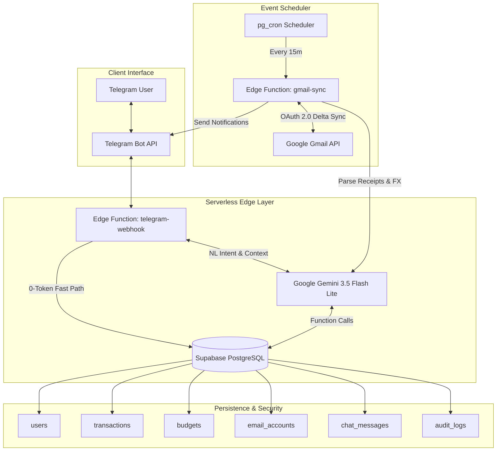

# Nopal AI Agent: Event-Driven Autonomous Financial Copilot & Enterprise Integration Engine

[](https://opensource.org/licenses/MIT)
[](https://supabase.com)
[](https://www.typescriptlang.org/)
[](https://deno.land/)
[](https://ai.google.dev/)

An enterprise-grade, token-optimized autonomous AI assistant platform built on Supabase Edge Computing (Deno Edge Functions, PostgreSQL RLS, `pg_cron`, `pg_net`), Telegram Bot API, Gmail OAuth 2.0 Integration, and the Google Gemini function-calling engine.

---

## Overview

Nopal AI Agent is an autonomous digital ledger and financial assistant designed to eliminate manual data entry. Operating via a Telegram interface and an automated background Gmail sync engine, the system processes transactions, monitors budgets, and provides proactive financial intelligence while maintaining strict security and low latency.

### Core Capabilities

* **Natural Language Transaction Logging:** Parses conversational inputs in plain Indonesian or English (e.g., "Beli kopi 25rb") and extracts amounts, categories, merchants, and dates into structured database records.
* **Automated Email Receipt Processing:** Periodically polls authorized Gmail inboxes for digital receipts and e-statements (BCA, Mandiri, Bank Jago, Jenius, GoPay, ShopeePay, AWS, GitHub), extracts transaction details, and requests human confirmation via Telegram.
* **Smart Budget & Daily Cap Monitoring:** Calculates dynamic safe daily limits based on monthly budget allocations, cycle dates, and historical spend, delivering proactive alerts when spending thresholds are breached.
* **Human-in-the-Loop Verification:** Uses interactive Telegram inline callback buttons to require explicit user approval before committing automated email transactions to the ledger.
* **Extensible Tool Engine:** Built on a decoupled tool registry architecture capable of supporting additional integrations such as calendar management, task tracking, and visual analytics.

---

## System Architecture

The application combines serverless edge functions with event-driven background scheduling and persistent relational storage.

### Topology Diagram

```text
┌─────────────────┐       Webhook / Keyboards       ┌────────────────────┐
│  Telegram User  │ <─────────────────────────────> │  Telegram Bot API  │
└─────────────────┘                                 └─────────┬──────────┘
                                                              │ POST /telegram-webhook
                                                              ▼
┌─────────────────────────────────────────────────────────────────────────────────────────┐
│ Serverless Edge Layer (Supabase Deno)                                                   │
│                                                                                         │
│   ┌────────────────────────────────┐  Fast Path (0-Token)  ┌────────────────────────┐   │
│   │ Edge Function: telegram-webhook├──────────────────────>│  Supabase PostgreSQL   │   │
│   └───────────────┬────────────────┘                       │  (Data, RLS, Audit)    │   │
│                   │                                        └───────────▲────────────┘   │
│                   │ Natural Language Intent                            │                │
│                   ▼                                                    │ Function Calls │
│   ┌────────────────────────────────┐                                   │                │
│   │ Google Gemini 3.5 Flash Lite   ├───────────────────────────────────┘                │
│   └────────────────────────────────┘                                                    │
└─────────────────────────────────────────────────────────────────────────────────────────┘

┌─────────────────────────────────────────────────────────────────────────────────────────┐
│ Automated Background Event Engine                                                       │
│                                                                                         │
│   ┌─────────────────┐   Every 15 Mins   ┌────────────────────────┐  OAuth 2.0 REST     │
│   │ pg_cron & pg_net├──────────────────>│ Edge Function:        ├──────────────┐        │
│   └─────────────────┘                   │ gmail-sync             │              │        │
│                                         └───────────┬────────────┘              ▼        │
│                                                     │                   ┌──────────────┐ │
│                                                     │ Parse Receipts    │ Google Gmail │ │
│                                                     ▼                   │ REST API     │ │
│                                         ┌────────────────────────┐      └──────────────┘ │
│                                         │ Gemini 3.5 Flash Lite  │                       │
│                                         └────────────────────────┘                       │
└─────────────────────────────────────────────────────────────────────────────────────────┘
```

<details>
<summary>View System Sequence Diagram (Mermaid)</summary>



</details>

---

## Architectural Highlights & Performance Design

* **Zero-Token Fast-Routing Engine:** Structured lookup commands (`/budget`, `/transactions`, `/sync`, `/email`, `/dailylimit`, `/pagi`) and single/multi-line shorthand expenses (e.g. `makan 20k`) bypass LLM reasoning entirely. Direct database execution yields sub-300ms response times with zero token cost.
* **Deterministic Structured JSON Output:** Native Google Gen AI JSON Schema enforcement guarantees schema compliance for tool calls and email receipt extraction.
* **Delta Sync Timestamp Cursors:** Uses `after:UNIX_TIMESTAMP` based on `last_synced_message_timestamp` to fetch only unread/new emails, cutting Gmail API Quota consumption by >85%.
* **Resilient Multi-Key Circuit Breaker:** Implements dynamic API key rotation and model fallback (`gemini-3.5-flash-lite` -> `gemini-3.6-flash`) to gracefully handle HTTP 429 rate limits.
* **Multi-Turn Conversation Memory Window:** Maintains persistent conversation history in `chat_messages` to support contextual corrections across interactions.
* **Multi-Currency Conversion:** Automatically converts foreign currencies (USD, EUR) to IDR using real-time rates for international digital receipts (e.g., ChatGPT, AWS, GitHub).
* **Parallel Worker Execution:** Batch processes multiple accounts using `Promise.allSettled` chunking to prevent execution timeouts on Deno Edge Workers.

---

## Configuration & Environment Variables

Create `.env` inside `supabase/functions/`:

| Variable | Description | Required |
| :--- | :--- | :--- |
| `ENCRYPTION_SECRET` | 32-byte secret key used for AES-256-GCM OAuth token encryption | Yes |
| `SUPABASE_URL` | Supabase project URL | Yes |
| `SUPABASE_SERVICE_ROLE_KEY` | Supabase service role secret key | Yes |
| `GEMINI_API_KEY` | Google AI Studio API key (Supports comma-separated list for key rotation) | Yes |
| `GEMINI_MODEL` | Default LLM model identifier (Default: `gemini-3.5-flash-lite`) | Yes |
| `TELEGRAM_BOT_TOKEN` | Telegram Bot API token issued by `@BotFather` | Yes |
| `TELEGRAM_SECRET_TOKEN` | Secret token header used for webhook verification | Yes |
| `GMAIL_CLIENT_ID` | OAuth 2.0 Web Client ID from Google Cloud Console | Yes |
| `GMAIL_CLIENT_SECRET` | OAuth 2.0 Web Client Secret from Google Cloud Console | Yes |
| `GMAIL_REDIRECT_URI` | Authorized OAuth 2.0 redirect URI | Yes |

---

## Operation & Deployment

### Automation Scripts (`package.json`)

| Command | Purpose |
| :--- | :--- |
| `npm run deploy` | Executes full deployment pipeline (migrations, secrets, functions) |
| `npm run deploy:db` | Applies database migrations to remote PostgreSQL database |
| `npm run deploy:secrets` | Synchronizes local environment variables to Supabase Cloud Secrets |
| `npm run deploy:functions` | Deploys all Edge Functions (`telegram-webhook`, `gmail-sync`) |
| `npm run deploy:webhook` | Deploys `telegram-webhook` Edge Function |
| `npm run deploy:gmail` | Deploys `gmail-sync` Edge Function |
| `npm run deploy:status` | Checks active Edge Function deployment status |
| `npm run migrate:crypto` | Runs AES-256 encryption migration on legacy OAuth tokens |
| `npm test` | Runs native automated unit test suite |

### Deployment Steps

1. Authenticate with Supabase CLI:
   ```bash
   npx supabase login
   ```

2. Link project and push database migrations:
   ```bash
   npx supabase link --project-ref <YOUR_PROJECT_REF>
   npx supabase db push
   ```

3. Upload environment secrets:
   ```bash
   npx supabase secrets set --env-file supabase/functions/.env --project-ref <YOUR_PROJECT_REF>
   ```

4. Deploy Deno Edge Functions:
   ```bash
   npx supabase functions deploy telegram-webhook --project-ref <YOUR_PROJECT_REF>
   npx supabase functions deploy gmail-sync --project-ref <YOUR_PROJECT_REF>
   ```

5. Register Telegram Webhook:
   ```text
   https://api.telegram.org/bot<TELEGRAM_BOT_TOKEN>/setWebhook?url=https://<PROJECT_REF>.supabase.co/functions/v1/telegram-webhook&secret_token=<TELEGRAM_SECRET_TOKEN>
   ```

---

## Directory Structure

```text
nopal-ai-agent/
├── README.md                     # System Documentation
├── BACKLOG.md                    # Product & Technical Roadmap
├── package.json                  # Dependencies & Operation Scripts
├── src/                          # Domain Logic & Core Application Modules
│   ├── agent/                    # LLM Engine, Fallback Circuit Breaker & Multi-Turn Memory
│   ├── config/                   # Configuration Wrappers & Environment Loaders
│   ├── db/                       # Database Data Access Layer (Users, Txs, Budgets, Audit, Chat)
│   ├── services/                 # Business Services (Gmail OAuth, Telegram Callbacks, Alerts)
│   ├── tools/                    # LLM Tool Declarations & Dispatch Handlers
│   ├── types/                    # System Interfaces & Contracts
│   └── utils/                    # Utility Functions (Crypto, Sanitization, Logger)
├── tests/                        # Automated Unit Tests
└── supabase/                     # Database & Infrastructure Layer
    ├── migrations/               # PostgreSQL Schemas, RLS Policies, Audit Logs, pg_cron Jobs
    └── functions/                # Serverless Deno Edge Functions (telegram-webhook, gmail-sync)
```

---

## Security & Compliance Architecture

* **AES-256-GCM Token Encryption:** Google Gmail OAuth refresh tokens are encrypted at rest using AES-256-GCM before storage (`src/utils/crypto.ts`).
* **PostgreSQL Row Level Security (RLS):** All primary tables (`transactions`, `budgets`, `audit_logs`, `chat_messages`) enforce strict RLS policies restricting data access `TO service_role` isolated per `user_id`.
* **Zero-Trust Webhook Authentication:** Webhook endpoints validate incoming requests using header verification (`X-Telegram-Bot-Api-Secret-Token`).
* **Immutable Audit Trail:** The `audit_logs` table revokes `UPDATE` and `DELETE` permissions for non-admin database roles to maintain non-repudiation.
* **Input Sanitization & Injection Protection:** User inputs are sanitized and truncated (max 2000 characters) before processing to guard against prompt injection.
* **Automated Unit Testing:** Automated testing runner (`npm test`) verifies financial calculations, date range computations, encryption roundtrips, and pre-filter parsing logic.

---

## License

Distributed under the [MIT License](LICENSE).
