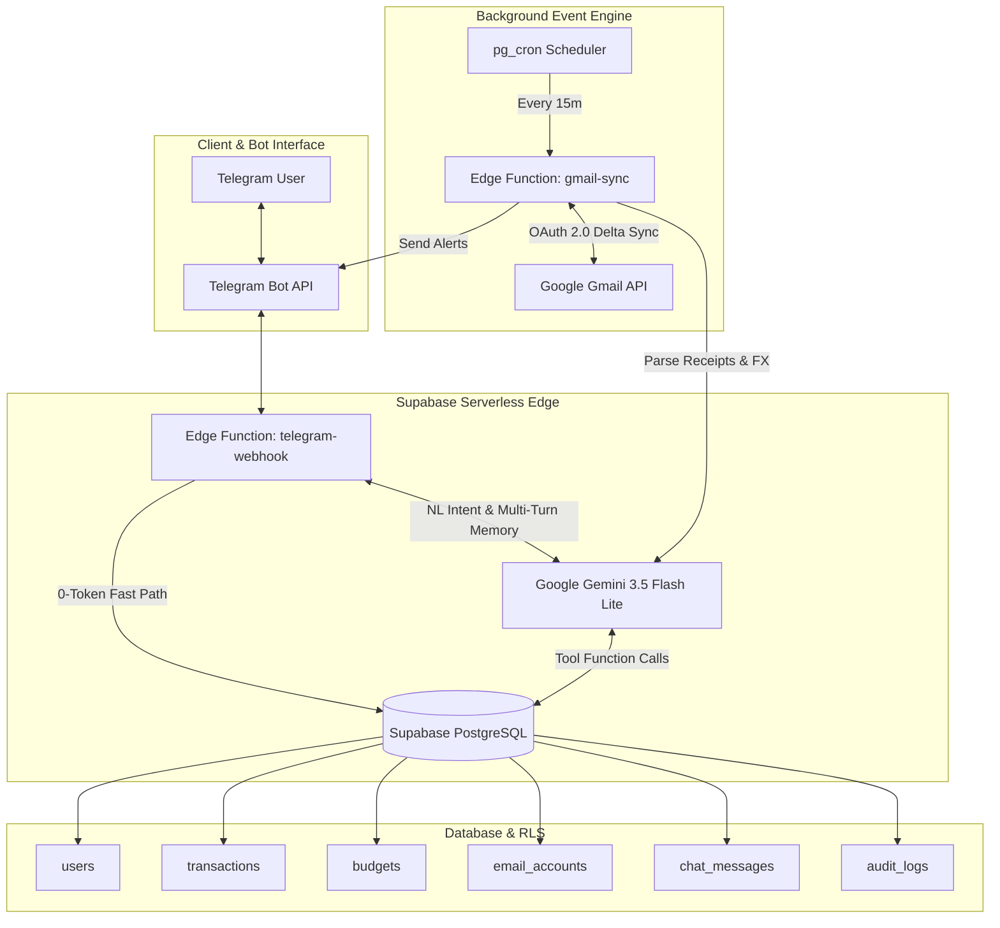

# 🤖 Nopal AI Agent — Modular Autonomous AI Assistant & Event-Driven Engine

[](https://opensource.org/licenses/MIT)
[](https://supabase.com)
[](https://www.typescriptlang.org/)
[](https://deno.land/)
[](https://ai.google.dev/)

> **An Enterprise-Grade, Token-Optimized Modular AI Assistant Platform** powered by **Supabase Edge Computing** (Deno Edge Functions, PostgreSQL RLS, `pg_cron`, `pg_net`), **Telegram Bot API**, **Gmail OAuth 2.0 Integration**, and **Google Gemini 3.5 Flash Lite** LLM function-calling engine.

---

## 🌟 Key Architectural Highlights

- **FinOps 0-Token Fast-Routing System**: Hybrid routing architecture that processes transactional lookup commands (`/budget`, `/transactions`, `/sync`, `/email`, `/confirm_all`) in `< 200ms` with **0 LLM token cost** via direct database paths, executing AI LLM reasoning only when ambiguous natural language or un-structured email parsing is required.
- **Multi-Turn Conversation Memory Window**: Persistent conversation history tracking (`chat_messages` table) enabling Gemini LLM to maintain context awareness for multi-turn corrections (e.g. *"Eh salah ding, tadi maksudku beli kopi 25rb"*).
- **Delta Sync Timestamp Cursor Engine**: Incremental Gmail message scanning using `after:UNIX_TIMESTAMP` cursors (`last_synced_message_timestamp`), reducing Google Gmail API quota consumption by **> 85%**.
- **Multi-Currency Auto Conversion**: Built-in foreign currency extraction and conversion engine ($USD / €EUR -> IDR) for international digital subscriptions (e.g., ChatGPT, GitHub, AWS).
- **Parallelized Edge Worker Execution**: Uses `Promise.allSettled` batch chunking to process multiple user accounts in parallel, eliminating Deno Edge 60-second HTTP timeouts.
- **Resilient Multi-Key & Multi-Model Fallback Rotation**: Built-in dynamic failover circuit breaker across model tiers (`gemini-3.5-flash-lite` -> `gemini-3.5-flash` -> `gemini-3.7-flash` -> `gemini-3.6-flash`) combined with round-robin API key rotation to handle HTTP 429 rate limits seamlessly.
- **Deterministic AI Structured Output**: Enforces Google Gen AI Native Type Schema JSON mode for 100% schema compliance, eliminating prompt extraction vulnerabilities and non-deterministic formatting errors.
- **Automated Event-Driven Background Engine**: Background financial receipt scanning using Supabase `pg_cron` & `pg_net` executing serverless edge worker invocations every 15 minutes to poll user-authorized Gmail inboxes automatically.
- **Dynamic Prompt Context Injection**: Dynamically injects user-configured budget limits into the LLM system prompt context at runtime, ensuring transactions are accurately mapped to user categories without category hallucinations.
- **Human-in-the-Loop (HIL) Financial Verification**: Two-phase state machine verification for extracted digital receipts (`pending_confirmation` -> `confirmed`) via interactive Telegram Inline Callback Keyboards.
- **Sanitized Multi-Bank HTML Parsing Pipeline**: HTML-to-Plain-Text strip-down pipeline capable of extracting transaction details accurately from bank e-statements and notifications (BRI, BCA, Mandiri, BNI, Bank Jago, Jenius, GoPay, ShopeePay, OVO, DANA), while filtering out mutual fund redemptions (*pencairan reksa dana*) and incoming transfers.

---

## 🏗 Architecture & System Topology

```text
┌─────────────────┐       Webhook / Keyboards       ┌────────────────────┐
│  Telegram User  │ <─────────────────────────────> │  Telegram Bot API  │
└─────────────────┘                                 └─────────┬──────────┘
                                                              │ POST /telegram-webhook
                                                              ▼
┌─────────────────────────────────────────────────────────────────────────────────────────┐
│ Serverless Edge Layer (Supabase Deno)                                                   │
│                                                                                         │
│   ┌────────────────────────────────┐  Fast Path (0-Token)  ┌────────────────────────┐   │
│   │ Edge Function: telegram-webhook├──────────────────────>│  Supabase PostgreSQL   │   │
│   └───────────────┬────────────────┘                       │  (Data, RLS, Audit)    │   │
│                   │                                        └───────────▲────────────┘   │
│                   │ Natural Language Intent                            │                │
│                   ▼                                                    │ Function Calls │
│   ┌────────────────────────────────┐                                   │                │
│   │ Google Gemini 3.5 Flash Lite   ├───────────────────────────────────┘                │
│   └────────────────────────────────┘                                                    │
└─────────────────────────────────────────────────────────────────────────────────────────┘

┌─────────────────────────────────────────────────────────────────────────────────────────┐
│ Automated Background Event Engine                                                       │
│                                                                                         │
│   ┌─────────────────┐   Every 15 Mins   ┌────────────────────────┐  OAuth 2.0 REST     │
│   │ pg_cron & pg_net├──────────────────>│ Edge Function:        ├──────────────┐        │
│   └─────────────────┘                   │ gmail-sync             │              │        │
│                                         └───────────┬────────────┘              ▼        │
│                                                     │                   ┌──────────────┐ │
│                                                     │ Parse Receipts    │ Google Gmail │ │
│                                                     ▼                   │ REST API     │ │
│                                         ┌────────────────────────┐      └──────────────┘ │
│                                         │ Gemini 3.5 Flash Lite  │                       │
│                                         └────────────────────────┘                       │
└─────────────────────────────────────────────────────────────────────────────────────────┘
```

<details>
<summary><b>Click to expand Mermaid Diagram (for Mermaid-enabled viewers)</b></summary>



</details>

---

## 💡 Key Optimization Strategies

- **Zero-Token Fast Paths**: Direct database lookups for menu and query commands (`/budget`, `/transactions`, `/sync`, `/email`, `/confirm_all`) bypass LLM reasoning completely. This lowers latency to direct DB query speeds and eliminates unnecessary token expenditure.
- **Delta Sync Timestamp Cursors**: Uses `after:UNIX_TIMESTAMP` based on `last_synced_message_timestamp` to fetch only unread/new emails, cutting Gmail API Quota consumption by >85%.
- **HTML Payload Sanitization**: Strips HTML tags, inline styling, and metadata from raw bank e-statement emails before sending to Gemini LLM. This drastically reduces input token payload size and avoids context window truncation.
- **Native Structured Output**: Leverages Google Gen AI native JSON schema enforcement rather than free-form text parsing with regex, guaranteeing 100% schema compliance for tool calls and receipt extractions.
- **Resilient Circuit Breaker & Key Rotation**: Implements multi-model fallback and API key round-robin rotation to seamlessly recover from HTTP 429 rate limits without service disruption.

---

## 📋 Environment Variables (`supabase/functions/.env`)

| Variable | Description |
| :--- | :--- |
| `ENCRYPTION_SECRET` | 32-Byte Key / Secret String for AES-256-GCM OAuth Token Encryption |
| `SUPABASE_URL` | Supabase Cloud Project Endpoint URL |
| `SUPABASE_SERVICE_ROLE_KEY` | Supabase Admin Service Role Secret Key |
| `GEMINI_API_KEY` | Google AI Studio API Key (Supports comma-separated keys for auto rotation) |
| `GEMINI_MODEL` | Default model: `gemini-3.5-flash-lite` |
| `TELEGRAM_BOT_TOKEN` | Bot API Token issued by `@BotFather` |
| `TELEGRAM_SECRET_TOKEN` | Security header secret for Telegram Webhook verification |
| `GMAIL_CLIENT_ID` | OAuth 2.0 Web Client ID from Google Cloud Console |
| `GMAIL_CLIENT_SECRET` | OAuth 2.0 Web Client Secret |
| `GMAIL_REDIRECT_URI` | OAuth Redirect Callback (`https://<PROJECT_REF>.supabase.co/functions/v1/gmail-sync/callback`) |

---

## 🚀 Deployment & Operations

### NPM Automation Commands

| Script Command | Description |
| :--- | :--- |
| `npm run deploy` | Full One-Command Deployment (Database Migrations + Cloud Secrets + Edge Functions) |
| `npm run deploy:db` | Apply database migrations to remote Supabase Cloud PostgreSQL |
| `npm run deploy:secrets` | Synchronize `.env` variables into Supabase Cloud Secrets |
| `npm run deploy:functions` | Deploy all serverless Deno Edge Functions (`telegram-webhook`, `gmail-sync`) |
| `npm run deploy:webhook` | Deploy `telegram-webhook` Edge Function |
| `npm run deploy:gmail` | Deploy `gmail-sync` Edge Function |
| `npm run deploy:status` | Audit active remote Deno Edge Functions status |
| `npm run migrate:crypto` | Execute automated AES-256 encryption migration on legacy unencrypted tokens |
| `npm test` | Run automated unit test suite (`crypto.test.ts`, `financial-math.test.ts`) |

### 1. Manual Supabase CLI Deployment

```bash
# 1. Authenticate Supabase CLI
npx supabase login

# 2. Link local repo with Supabase Cloud Project & apply migrations
npx supabase link --project-ref <YOUR_PROJECT_REF>
npx supabase db push

# 3. Upload environment secrets to Cloud Vault
npx supabase secrets set --env-file supabase/functions/.env --project-ref <YOUR_PROJECT_REF>

# 4. Deploy Deno Serverless Edge Functions
npx supabase functions deploy telegram-webhook --project-ref <YOUR_PROJECT_REF>
npx supabase functions deploy gmail-sync --project-ref <YOUR_PROJECT_REF>
```

### 2. Register Telegram Webhook

To connect your Telegram Bot to your deployed Edge Function with secret header verification:
```text
https://api.telegram.org/bot<YOUR_TELEGRAM_BOT_TOKEN>/setWebhook?url=https://<YOUR_PROJECT_REF>.supabase.co/functions/v1/telegram-webhook&secret_token=<YOUR_TELEGRAM_SECRET_TOKEN>
```

---

## 🔑 API Keys & Cloud Credentials Setup

### 1. Google Gemini AI API (Free Tier Available)
1. Navigate to **[Google AI Studio](https://aistudio.google.com/)**.
2. Click **"Get API key"** -> **"Create API key in new project"**.
3. Copy the API Key (`AIzaSy...`) into `GEMINI_API_KEY` inside `supabase/functions/.env`.

### 2. Telegram Bot API Token
1. Open Telegram and message **`@BotFather`**.
2. Send `/newbot`, assign a bot handle, and copy the token into `TELEGRAM_BOT_TOKEN`.

### 3. Google Gmail OAuth 2.0 Credentials
1. Open **[Google Cloud Console](https://console.cloud.google.com/)**.
2. Create project `Nopal Financial Agent` and enable **Gmail API**.
3. Under **OAuth Consent Screen**, configure External audience and add standard `email` and `https://www.googleapis.com/auth/gmail.readonly` scopes.
4. Under **Credentials**, create a **Web Application** credential.
5. Set Authorized Redirect URI: `https://<YOUR_PROJECT_REF>.supabase.co/functions/v1/gmail-sync/callback`.
6. Copy `Client ID` and `Client Secret` into `supabase/functions/.env`.

---

## 📁 Repository Structure

```text
nopal-ai-agent/
├── README.md                     # Architecture & Setup Guide
├── package.json                  # Dependencies & NPM Operations Tooling
├── src/                          # Domain Logic & Modules
│   ├── agent/                    # Gemini Agentic Engine, Fallback Circuit Breaker & Multi-Turn Memory
│   ├── config/                   # Centralized Configuration & Environment Wrappers
│   ├── db/                       # Supabase Data Access Layer (Users, Txs, Budgets, Audit, Chat)
│   ├── services/                 # Enterprise Services (Gmail OAuth, Telegram Callbacks, Alerts)
│   ├── tools/                    # LLM Tool Declarations & Dispatch Handlers
│   └── types/                    # Core TypeScript Types & System Contracts
└── supabase/                     # Infrastructure & Serverless Functions
    ├── migrations/               # PostgreSQL Schemas, RLS, Audit Logs, Chat Memory & pg_cron Jobs
    └── functions/                # Deno Edge Functions (telegram-webhook & gmail-sync)
```

---

## 🛡️ Security & Privacy (SOC 2 & ISO 27001 Aligned)

- **AES-256-GCM OAuth Token Encryption**: All Google Gmail OAuth refresh tokens are encrypted at rest using AES-256-GCM before being stored in the database (`src/utils/crypto.ts`).
- **Row Level Security (RLS)**: PostgreSQL tables (`transactions`, `budgets`, `audit_logs`, `chat_messages`) are strictly protected using Supabase RLS policies restricted `TO service_role` and isolated per `user_id`.
- **Zero-Trust Identity Authentication**: Telegram Webhook callbacks dynamically authenticate sender identity from payload headers (`X-Telegram-Bot-Api-Secret-Token`), eliminating IDOR vulnerabilities.
- **Immutable Audit Trail (`audit_logs`)**: Enforces non-repudiation by revoking `UPDATE` and `DELETE` grants from `PUBLIC`, `authenticated`, and `anon` roles for SOC 2 Type II and ISO 27001 compliance audits.
- **AI Input Sanitization & Guardrails**: Sanitizes incoming user messages, limits character lengths (max 2000 chars), and enforces strict system prompt immutability against prompt injection attacks.
- **Automated Unit Testing Suite**: Continuous quality assurance verified by Node native test runner (`npm test`).

---

## 📄 License

This repository is distributed under the [MIT License](LICENSE).
